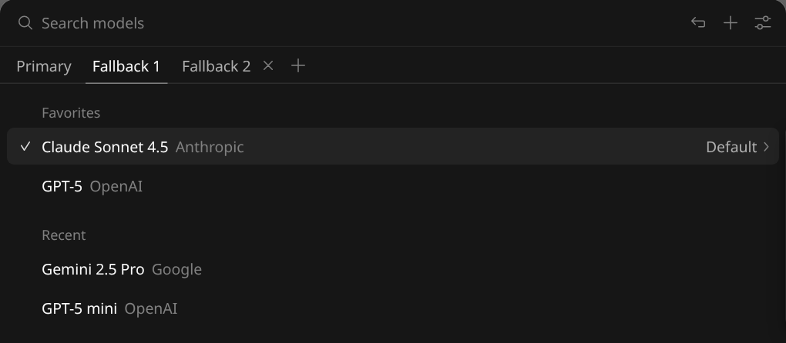

# Manage Agents

**Set default models for OpenCode agents.**

## Install

```sh
opencode plugin add 'github:abran-labs/opencode-manage-agents#v0.1.0'
```

Tested on Linux with OpenCode 2.4.0. Saving changes requires `flock` (util-linux).

## Terminal (TUI)

Run `/agents` or select **Manage agents** from the command palette. Pick a primary agent or subagent, then search for a model. Saving changes that agent’s default across projects, not the model selected in your current chat.

| Control | Action |
| --- | --- |
| `↑` / `↓` | Move through models |
| `Tab` / `Shift+Tab` | Switch between model slots |
| `Ctrl+T` | Cycle variants when available |
| `Enter` | Save the selected model to this slot |
| `Ctrl+R` | Reset the agent default or clear this fallback |
| `Alt+N` or `+` | Add a fallback slot |
| `Ctrl+D` or `×` | Close the last fallback slot |
| `Esc` | Close the picker |

Fallbacks are off until you choose a backup model. After setting a default, add up to 20 fallback models per agent. If a model is rate-limited, backups are tried in slot order. You can clear any fallback, but only the last fallback slot can be closed. Resetting the default clears that agent’s fallbacks.

## Desktop (experimental)

On OpenCode Desktop 2.4.0, open **Manage agents** from the agent menu or command palette. It edits the same defaults as the terminal picker.



## Uninstall

```sh
opencode plugin remove 'github:abran-labs/opencode-manage-agents#v0.1.0'
```

Saved agent defaults stay in OpenCode after uninstalling.
